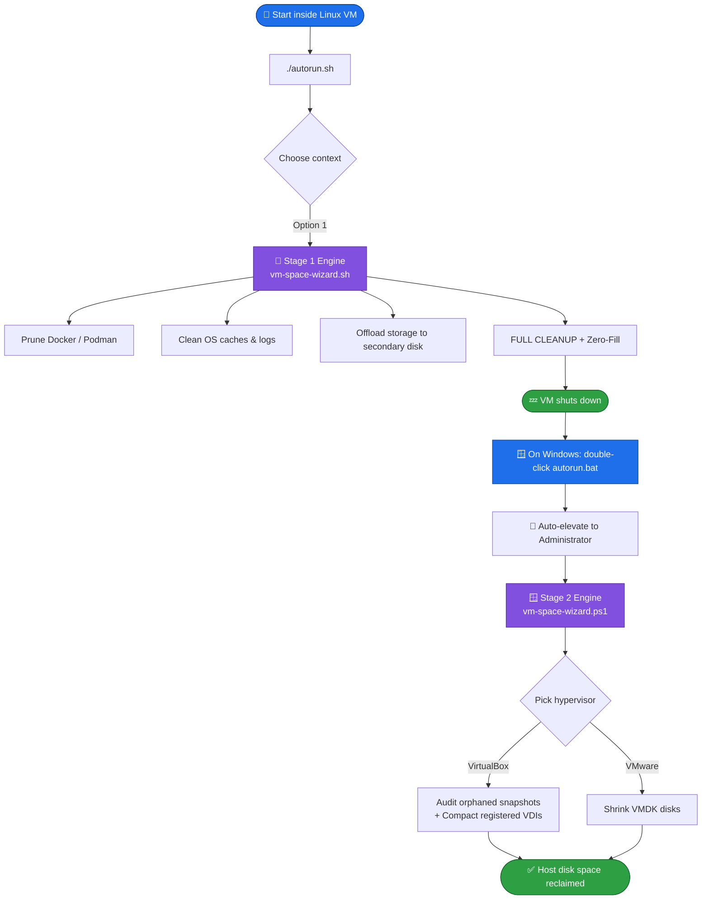

<div align="center">

# 🧙‍♂️ VM Space Wizard
### *Universal Cross-Platform VM Disk Optimization & Host Compaction Suite*


**Reclaim the disk space your VM never gives back — safely, automatically, and without touching Windows Explorer.**

Deleting files inside a Linux guest never shrinks the `.vdi` or `.vmdk` file on your host. VM Space Wizard is a guided, two-stage pipeline that cleans your guest, zero-fills the freed blocks, and then compacts the physical disk file on your host — without ever risking the snapshot chain.

[**Why**](#-why-this-exists) · [**Features**](#-features) · [**Install**](#-installation) · [**Usage**](#-usage-the-two-stage-workflow) · [**Preview**](#-menus-at-a-glance) · [**Safety**](#-safety-guardrails) · [**Structure**](#-repository-structure) · [**FAQ**](#-faq--troubleshooting)

</div>

---

## 💡 Why This Exists

Shrinking a VM's disk footprint is deceptively hard:

- 🗑️ You delete gigabytes of logs, Docker images, and package caches *inside* the guest OS — but the `.vdi` / `.vmdk` on your host stays exactly the same size.
- ⚠️ The common "fix" — manually deleting snapshot files from Windows Explorer — **breaks the hypervisor's media registry** and can corrupt the entire VM.
- 🧩 Actually compacting a disk requires a specific sequence: clean the guest → zero-fill the unused blocks → shut down → compact from the *host*, using the correct hypervisor CLI tool.
- 🐳 Container engines (Docker/Podman) are frequently the biggest offenders, silently consuming tens of gigabytes in build caches, dangling images, and unused volumes.

**VM Space Wizard automates this entire pipeline behind two simple menus** — one inside your Linux guest, one on your Windows host — so reclaiming real disk space takes minutes, not a support-forum deep dive.

---

## ✨ Features

### 🐧 Stage 1 — Linux Guest Engine (`linux/vm-space-wizard.sh`)

| Feature | Details |
|---|---|
| 🌍 **Universal distro support** | Debian, Ubuntu, Kali Linux, CentOS, RHEL, Fedora, and Rocky Linux — auto-detects `apt`, `dnf`, or `yum` |
| 🐳 **Granular container pruning** | Selectively prune Docker & Podman: build caches only, unused volumes only, stopped containers only, dangling images only, or a full deep clean |
| 💾 **Full Docker/Podman/containerd storage migration** | `linux/docker-storage-migrate.sh`: detects your storage driver first (see the driver matrix below) and picks a matching copy method and target filesystem, stops Docker, containerd and Podman cleanly, copies existing images/containers/volumes/networks to the new disk, mounts it at `/var/lib/docker`, bind-mounts `/var/lib/containerd` from it, points Podman's rootless **and** rootful `storage.conf` (graphroot + runroot) at it, verifies before/after image/container/volume counts, and rolls back automatically on any failure — original data on the root disk is never deleted automatically |
| 🔍 **"Detected setup" summary before anything happens** | Storage driver, containerd snapshotter mode, filesystem types, a custom `daemon.json` data-root, snap-installed/rootless Docker, and the init system are all detected and printed before the migration plan — and nothing is formatted or copied until that plan is confirmed |
| 🔁 **Persistent across reboots, safely** | fstab entries use `nofail` (a detached disk never hangs boot) and are backed up + validated with `findmnt --verify` before being kept; a systemd drop-in adds `RequiresMountsFor=` so `docker.service` always waits for the disk to actually be mounted |
| 🧯 **Rollback & crash recovery** | Any failed step reverts mounts/fstab/the systemd drop-in automatically; if the wizard itself is killed mid-migration, a state file is detected and reported on the next launch so you know nothing silently broke |
| 🗑️ **Cleanup renames before it deletes** | The audit/cleanup menu renames leftover root-disk copies to `*.bak` first; permanently deleting that backup always needs a separate, real confirmation — even with `--yes` |
| 🧪 **`--dry-run` and `--yes`** | Preview every state-changing step with `--dry-run`, or automate the whole flow non-interactively with `--yes` (the final backup deletion still always asks for real) |
| 📖 **In-menu attachment guides** | Step-by-step instructions for attaching a second virtual disk in both **Oracle VirtualBox** and **VMware Workstation/Player**, shown right when you need them |
| 🧽 **OS-level cleanup** | Clears package manager caches (`apt`/`dnf`/`yum`/`pacman`/`zypper`), vacuums `systemd` journal logs (keeps last 3 days, skipped with a warning on non-systemd), and clears temp/thumbnail caches older than a day (never a blind `rm -rf /tmp/*`) |
| 🔄 **Zero-fill sequence** | Writes zeroes to a real on-disk directory (checked against `/tmp` being tmpfs first — writing to RAM-backed `/tmp` would never free anything), then gracefully shuts the VM down |
| 🌐 **Global CLI install** | Registers itself as `clean-wizard`, runnable from any terminal, any directory |

#### Storage driver matrix

Docker's storage driver decides how layers are actually laid out on disk, and that decides how they can be safely copied — the wizard detects yours and picks accordingly, rather than assuming everyone is on overlay2/ext4:

| Driver | Target filesystem | Copy method | Why |
|---|---|---|---|
| `overlay2` (classic graphdriver) | ext4, or xfs with `ftype=1` | plain file copy (`rsync -aHAXS`) | layers are ordinary files/directories; any filesystem that supports them works |
| `overlayfs` + containerd snapshotter (`driver-type: io.containerd.snapshotter.v1`) | ext4, or xfs with `ftype=1` | plain file copy (`rsync -aHAXS`) | same reasoning as overlay2 — still ordinary files, just managed by containerd's snapshotter plugin instead of dockerd's graphdriver code |
| `vfs`, `aufs`, `fuse-overlayfs` | ext4, or xfs with `ftype=1` | plain file copy (`rsync -aHAXS`) | same reasoning — no subvolumes/snapshots involved |
| `btrfs` | **must be btrfs** (requires `btrfs-progs`, checked and clearly reported if missing) | **portable mode**: `docker save`/`load` for images, `rsync` for volumes (volumes are plain directories regardless of driver), containers recreated from their captured `docker inspect` config | the btrfs driver stores every layer as a btrfs subvolume; a plain copy would flatten them into ordinary directories, losing the "is a subvolume" property the driver depends on. See the design note in `docker-storage-migrate.sh` above `migrate_docker_storage_btrfs()` for the full reasoning, including the cost: anything a container wrote outside a volume is **not** preserved in portable mode — only volumes and the container's configuration (image, env, ports, restart policy, mounts, labels, network membership) survive |
| `zfs` | **refused, before touching anything** | none — not supported | same structural problem as btrfs (layers are zpool datasets/snapshots), but with no send/receive support implemented here; migrate it yourself with `zfs send`/`receive`, or switch to overlay2 first |

**Known limitations:** Docker installed via snap, or run in rootless mode, uses a different data path than the default `/var/lib/docker` this wizard targets — detected and reported, but not automatically redirected to. Container recreation in btrfs/portable mode covers name, image (every tag it had, not just one — multi-tag and dangling-but-in-use images are restored by name, not left as `<none>:<none>`), env, restart policy, published ports, volume/bind mounts, labels, working dir, network membership, user, privileged mode, added/dropped capabilities, devices, memory/CPU limits, and `CMD-SHELL`-form health checks. It does **not** reconstruct a multi-part entrypoint beyond its first element, an exec-form health check, or exotic settings like DNS/extra-hosts/sysctls/ulimits/pids-limit — anything it can't reconstruct is printed as a named warning for that specific container, never silently dropped. Dependency checks (rsync, findmnt, blkid, and — for btrfs — jq or python3) all run up front, before anything is formatted, not discovered partway through; if `jq` isn't installed (it has no package candidate on some distros, e.g. ParrotOS), the btrfs path's JSON parsing transparently falls back to a bundled python3 helper instead of refusing. The free-space check before a btrfs migration accounts for both the volumes being copied and the images `docker save` is about to write onto the same target disk. Podman support and the btrfs/portable pipeline were written, reviewed, and exercised against loop-file disks with a stub Docker daemon (see Testing below) but could not be run-tested against a real Podman installation or a real btrfs-backed Docker daemon in this project's own development environment — the overlay2/rsync path *was* run-tested against this project's real (non-btrfs) Docker daemon's actual driver output.

### 🪟 Stage 2 — Windows Host Engine (`modules/vm-space-wizard.ps1`)

| Feature | Details |
|---|---|
| 🖥️ **Multi-hypervisor support** | **Oracle VirtualBox** (`.vdi`) via `VBoxManage.exe`, and **VMware Workstation/Player** (`.vmdk`) via `vmware-vdiskmanager.exe` — both skip/warn on disks belonging to a currently running VM instead of risking corruption |
| 🐳 **Docker Desktop / Podman (WSL2) relocation** | Moves Docker Desktop's and/or Windows-host Podman's WSL2 virtual disks to another drive via the documented `wsl --export`/`--unregister`/`--import` workflow — they're re-registered under the same distro name, so Docker Desktop/Podman need no reconfiguration afterward |
| 🔍 **Orphaned snapshot auditor** | Cross-references every physical `.vdi` file on disk against VirtualBox's media registry, flags anything unregistered, and offers a guided, confirmed deletion to reclaim space safely |
| 📦 **Registered disk compactor** | Lists every disk VirtualBox actually knows about and compacts one, several, or all of them via `VBoxManage modifymedium --compact` |
| 🔐 **Automated elevation** | `autorun.bat` self-elevates to Administrator — required for hypervisor CLI access — with zero manual UAC hunting |
| 🧩 **Modular architecture** | Hypervisor/WSL logic is cleanly separated into `virtualbox-engine.ps1`, `vmware-engine.ps1` and `docker-desktop-engine.ps1`, loaded dynamically by the master entry point |

**Known limitation:** the Windows-side modules were written against the documented `VBoxManage`/`vmware-vdiskmanager`/`wsl.exe` CLIs and syntax/lint-checked (PSScriptAnalyzer, PowerShell 5.1- and 7-compatible syntax only), but this project was built and tested on Linux with no Windows/VirtualBox/VMware/WSL available — **run-test these on your actual Windows host before relying on them**, especially `Shrink-VMwareDisks` and the WSL2 relocation functions.

---

## 🛠️ Installation

### Requirements

| | 🐧 Linux Guest | 🪟 Windows Host |
|---|---|---|
| **Shell** | Bash | Windows PowerShell (bundled) |
| **Privileges** | `sudo` | Administrator (auto-elevated) |
| **Software** | `lsblk`, `blkid`, `dd`, `rsync`, `findmnt` (util-linux) for migration; `systemctl` for the systemd drop-in (warns and skips it otherwise); Docker and/or Podman | Oracle VirtualBox and/or VMware Workstation/Player installed at their default paths; `wsl.exe` for Docker Desktop/Podman relocation |

### Clone the repository

```bash
git clone https://github.com/ali4210/Disk_CleanUp_Project.git
cd Disk_CleanUp_Project/My_Custom_VM_Cleaning_Wizard
```

### 🐧 Set up inside your Linux VM

```bash
chmod +x autorun.sh
./autorun.sh
```

> Permissions are also self-healing: `autorun.sh` automatically runs `chmod +x` on every `.sh` file in the repository each time it launches.

### 🪟 Set up on your Windows host

Simply **double-click `autorun.bat`**. It requests Administrator rights automatically (required for `VBoxManage.exe` and hypervisor disk access) and opens the master launcher menu.

### 🌐 Optional: install as a global command (Linux)

```bash
bash install.sh
```

This symlinks the Linux engine to `/usr/local/bin/clean-wizard`, so you can run `clean-wizard` from any directory without `cd`-ing into the repo.

---

## 🚀 Usage: The Two-Stage Workflow



### 📍 Stage 1 — Inside the Linux Guest

1. Clone or copy the repository into your VM.
2. Run the launcher:
   ```bash
   chmod +x autorun.sh
   ./autorun.sh
   ```
3. Select **`[1] Running inside LINUX GUEST`**.
4. From the main menu, run whichever tasks you need:
   - **`[1]`** Free up container space (choose granular pruning or a full deep clean)
   - **`[2]`** Free up OS system space (package caches, logs, temp files)
   - **`[3]`** Offload Docker/Podman storage to a secondary disk
   - **`[4]`** **FULL CLEANUP + Zero-Fill** — runs everything above, then zero-fills unused blocks and **shuts the VM down automatically**

### 📍 Stage 2 — On the Windows Host

1. Confirm Stage 1 has finished and the VM is shut down.
2. Double-click **`autorun.bat`** and accept the Administrator prompt.
3. Select **`[2] Stage 2: Windows Host VDI/VMDK Compaction + Docker Desktop/Podman Relocation`**.
4. Choose your hypervisor:
   - **VirtualBox** → audit orphaned snapshots, then compact one/several/all registered `.vdi` disks
   - **VMware** → shrink `.vmdk` disks
5. Watch your `.vdi`/`.vmdk` file shrink on disk. Done.

---

## 🖥️ Menus at a Glance

<details>
<summary><b>🐧 Linux Stage 1 — Main Menu</b></summary>

```text
====================================================================
         🧙‍♂️ VM SPACE WIZARD - SYSTEM & CONTAINER OPTIMIZER
====================================================================
Please select an action:

  [1] Free Up Container Space (Customizable Docker & Podman Prune)
  [2] Free Up OS System Space (Clean Package Caches & Logs)
  [3] Offload Docker & Podman Storage to Secondary HDD Drive
  [4] FULL CLEANUP + Zero-Fill for Host Disk Compaction (Stage 1)
  [5] Audit & Clean Up Leftover Storage After a Migration
  [0] Exit
```

</details>

<details>
<summary><b>🐳 Container Pruning Submenu</b></summary>

```text
[+] Granular Container Cleanup Engine (Docker & Podman)

  [1] Prune Build Caches Only (Safe: Keeps images & containers)
  [2] Prune Unused Volumes Only (Deletes unattached volumes)
  [3] Prune Stopped Containers Only (Deletes non-running containers)
  [4] Prune Dangling Images Only (Untagged image layers)
  [5] FULL DEEP CLEAN (Prune ALL unused containers, images, volumes & caches)
  [0] Return to Main Menu
```

</details>

<details>
<summary><b>🪟 Windows Master Launcher (autorun.bat)</b></summary>

```text
====================================================================
         VM SPACE WIZARD - MASTER LAUNCHER (WINDOWS)
====================================================================
Which stage of the cleanup process are you currently executing?

  [1] Stage 1: Linux System Cleanup
  [2] Stage 2: Windows Host VDI/VMDK Compaction + Docker Desktop/Podman Relocation
  [0] Exit
```

</details>

<details>
<summary><b>🪟 Windows Stage 2 — Platform Selection</b></summary>

```text
====================================================================
  VM SPACE WIZARD V2.1 - UNIVERSAL HYPERVISOR COMPACTOR
====================================================================
Select your virtualization platform:

  [1] Oracle VirtualBox (.vdi)
  [2] VMware Workstation / Player (.vmdk)
  [3] Docker Desktop / Podman on Windows (WSL2 data relocation)
  [0] Exit
```

```text
--- ORACLE VIRTUALBOX ENGINE ---

  [1] Compact Registered VDI Disks and Active Snapshot Chains
  [2] Audit and Clean Orphaned / Corrupted Snapshot Files
  [3] Run Full Maintenance (Audit + Compact All)
  [0] Back to Platform Selection
```

```text
--- DOCKER DESKTOP / PODMAN (WSL2) ENGINE ---

  [1] Relocate Docker Desktop's WSL2 data to another drive
  [2] Relocate Windows-host Podman's WSL2 machine data to another drive
  [0] Back to Platform Selection
```

</details>

---

## 🛡️ Safety Guardrails

VM Space Wizard touches destructive operations (disk formatting, snapshot deletion, container pruning), so it is built with explicit safety rails at every dangerous step:

| Guardrail | What it prevents |
|---|---|
| 🚫 **Root/boot/swap/partitioned-disk protection** | The migration refuses a target that contains your root OS, `/boot`, `/boot/efi`, swap, or that is a whole disk with existing partitions — pick the partition/disk itself |
| 🔍 **Filesystem detection before format** | Checks for an existing filesystem via `lsblk` first — a pre-formatted drive with data is **never** silently reformatted |
| 📏 **Free-space precheck** | Refuses to start copying if the target disk doesn't have (existing data × 1.1) free, instead of failing partway through |
| ↩️ **Automatic rollback** | Any failure during stop/copy/mount/fstab/start/verify reverts every change (mounts, fstab, the systemd drop-in) back to the pre-migration state; the root disk's original data is never touched by the migration step itself |
| 🧾 **Rename-before-delete cleanup** | The leftover-cleanup menu renames old root-disk copies to `*.bak` first; actually deleting that backup is a separate step that always needs a real confirmation, even under `--yes` |
| ✅ **Confirmation prompts** | Every destructive action (formatting a disk, migrating, zero-filling, deleting an orphaned snapshot, a full container prune) requires an explicit confirmation — satisfiable non-interactively via `--yes`, except the final backup deletion |
| 🔎 **Registry cross-check before deletion** | Orphaned snapshot detection only flags `.vdi` files that are physically present **and** absent from VirtualBox's own media registry — never a randomly-selected file |
| 🧩 **Safe container pruning tiers** | Build-cache-only pruning is offered as a non-destructive first option, separate from the full system prune, which now also requires a typed `YES` confirmation |
| 🔐 **Scoped elevation** | Windows scripts only request Administrator rights for Stage 2 (hypervisor CLI access) — Stage 1 never needs elevated Windows privileges |

---

## 📁 Repository Structure

```text
Disk_CleanUp_Project/
└── My_Custom_VM_Cleaning_Wizard/
    ├── 🚀 autorun.sh                    # Universal master launcher (Linux)
    ├── 🚀 autorun.bat                   # Universal master launcher (Windows, self-elevating)
    ├── 📦 install.sh                    # Registers 'clean-wizard' as a global command
    ├── 📖 README.md
    ├── 🐧 linux/
    │   ├── vm-space-wizard.sh           # Stage 1: Linux system & container engine (menus)
    │   └── docker-storage-migrate.sh    # Full Docker/containerd/Podman migration pipeline
    ├── 🪟 modules/
    │   ├── vm-space-wizard.ps1          # Stage 2: Windows master entry point
    │   ├── virtualbox-engine.ps1        # VirtualBox VDI compaction & snapshot audit
    │   ├── vmware-engine.ps1            # VMware VMDK shrink engine
    │   ├── docker-desktop-engine.ps1    # Docker Desktop / Podman WSL2 relocation
    │   └── banner.txt                   # ASCII banner used by autorun.bat
    └── 🧪 tests/
        ├── run-tests.sh                 # Isolated test suite (loop disks, fake docker/systemctl)
        └── fakebin/                      # Stub docker/systemctl used only by the test suite
```

**Tech stack:** Bash · Windows PowerShell · Batch

---

## 🔍 What Runs Under the Hood

| Action | What actually executes |
|---|---|
| Container build-cache prune | `docker builder prune -f` / `podman builder prune -f` |
| Full container deep clean | `docker system prune -a --volumes -f` / `podman system prune -a --volumes -f` (now behind a typed `YES` confirmation) |
| OS cache cleanup | `apt-get clean && apt-get autoremove -y` (or the `dnf`/`yum`/`pacman`/`zypper` equivalent) |
| Log cleanup | `journalctl --vacuum-time=3d` (skipped with a warning if systemd isn't present) |
| Storage migration | stop `docker.socket`/`docker.service`/`containerd.service`/podman → `rsync -aHAXS --numeric-ids` existing data → mount the disk at `/var/lib/docker` → bind-mount `/var/lib/containerd` → update `/etc/fstab` (`nofail`, backed up, `findmnt --verify`'d) → systemd drop-in (`RequiresMountsFor=`) → restart → verify → roll back on any failure |
| Podman storage repoint | Writes `graphroot` + `runroot` into `~/.config/containers/storage.conf` (rootless) and/or `/etc/containers/storage.conf` (rootful); enables `podman.socket` |
| Leftover cleanup | Renames old root-disk copies to `*.bak`; permanently deleting them is a separate, always-interactive confirmation |
| Zero-fill | Verifies the fill directory isn't tmpfs (RAM-backed `/tmp` would do nothing), then `dd if=/dev/zero of=<realdir>/.vmwizard-zero.fill bs=1M` until the disk fills, then removes the fill file |
| VDI orphan audit | Diffs `VBoxManage list hdds` against every `.vdi` under `%USERPROFILE%\VirtualBox VMs` |
| VDI compaction | `VBoxManage modifymedium disk <path> --compact` |
| VMDK shrink | `vmware-vdiskmanager.exe -k <path>`, skipping any disk whose VM `vmrun -T ws list` reports as running |
| Docker Desktop / Podman WSL2 relocation | `wsl --shutdown` → `wsl --export <distro> <tar>` → `wsl --unregister <distro>` → `wsl --import <distro> <newdir> <tar> --version 2` |
| Global CLI install | `ln -sf linux/vm-space-wizard.sh /usr/local/bin/clean-wizard` |

---

## 🩺 FAQ & Troubleshooting

<details>
<summary><b>❓ I ran Stage 1 but my Windows disk file didn't shrink — why?</b></summary>

<br/>

Stage 1 only *prepares* the disk (cleans + zero-fills) and shuts the VM down. You still need to run **Stage 2 on the Windows host** (`autorun.bat` → Option 2) to actually compact the `.vdi`/`.vmdk` file. Compaction can only happen while the VM is powered off and from the host side.

</details>

<details>
<summary><b>⚠️ The secondary disk setup refused my selected drive</b></summary>

<br/>

That's the root-drive protection working as intended — you selected the disk that holds your active Linux OS. Pick a genuinely secondary/attached virtual disk instead. Use the in-menu VirtualBox/VMware attachment guide if you haven't created one yet.

</details>

<details>
<summary><b>🪟 "Could not locate vm-space-wizard.ps1"</b></summary>

<br/>

Ensure the repository's folder structure is intact — the script expects to find its module files inside `modules/`. Re-clone the repository if files were moved or partially downloaded.

</details>

<details>
<summary><b>🐳 Podman commands aren't running</b></summary>

<br/>

All Podman operations are wrapped in `command -v podman &>/dev/null` checks and fail silently if Podman isn't installed — only Docker will run. Install Podman if you need both engines pruned.

</details>

<details>
<summary><b>🔐 Why does Stage 2 need Administrator rights?</b></summary>

<br/>

`VBoxManage.exe` and hypervisor disk compaction require elevated access to read and modify virtual disk files on the host filesystem. `autorun.bat` requests this automatically via `net session` detection and a `RunAs` relaunch.

</details>

---

## 🧪 Testing

`tests/run-tests.sh` exercises the full migration pipeline for real — fresh migration, migration with pre-existing images/volumes, idempotent re-run, `--dry-run`, rollback-on-verification-failure, interrupted-run detection, wrong-device/too-small/partitioned-disk refusals, rename-before-delete cleanup, driver detection and filesystem matching (including a real loop-file **btrfs** disk, real `mkfs.xfs ftype=0/1`, and a refusal when `btrfs-progs` is missing), the full btrfs/portable migration (image save/load, volume rsync, container recreation with env/ports/restart-policy/mounts/network membership verified field-by-field), and that the plain-rsync path refuses a btrfs-driver setup — all without ever touching a real block device, the real Docker daemon, real systemd units, or `/etc/fstab`.

It also covers nine defects found running this tool for real on a ParrotOS VM (btrfs, Docker 20.10, migration to a second disk, then a reboot) — each with a test that fails on the pre-fix code and passes on the fix:

| # | Defect | Fix |
|---|---|---|
| 1 | `docker save` was given bare image IDs, so `docker load` returned every image as `<none>:<none>` | Images are saved by name (every tag, not just one); a dangling-but-in-use image is re-tagged from its last-known name after load |
| 2 | `mig_state_set`'s plain `>` redirect failed silently with "Permission denied" against the root-owned state dir, so crash recovery never recorded anything | Goes through `$SUDO tee`, like the directory create that made it root-owned in the first place |
| 3 | A container's `Cmd`/`Entrypoint` were dropped on recreate — `sleep 86400` became a restart loop | Entrypoint/Cmd/User/Privileged/CapAdd/CapDrop/Devices/Memory/CPUs/health check are now carried over; anything still not reconstructed (a multi-part entrypoint, an exec-form health check, DNS/extra-hosts/sysctls/ulimits/pids-limit) is a named warning, never a silent drop |
| 4 | The temporary root-disk view (`/mnt/.vmwiz-rootview.*`) stayed mounted after a successful migration | Unmounted (lazily if busy) on every exit path, success or failure, including this run's own exit trap |
| 5 | The target disk was formatted before the tool discovered `jq` was missing (no package candidate on some distros, e.g. ParrotOS) | All prerequisite checks run before any format prompt; if `jq` is missing, the btrfs path's JSON parsing falls back to a bundled python3 helper instead of refusing |
| 6 | The free-space check only counted the volumes directory, not the images `docker save` was about to write onto the same disk | Counts volumes + total image size (deduplicated by image id) with the same safety margin |
| 7 | The final message claimed Podman storage was "now live" even when Podman was skipped (already had its own data, or wasn't installed) | Lists exactly what moved and what was skipped, and why, per component |
| 8 | Reclaim-leftovers hints said "menu option [5]", which goes stale the moment menus are renumbered | Named by the menu entry's actual text instead |
| 9 | A reboot renamed the target disk from `/dev/sdb` to `/dev/sda`; the state file and "already migrated" detection only knew the old name | State file records the disk's UUID alongside its `/dev` name; `mig_verify` and "already migrated" detection compare by UUID, not name |

```bash
sudo bash tests/run-tests.sh
```

It uses loop devices backed by sparse files under `/tmp`, stub `docker`/`systemctl` binaries, and a throwaway fstab/root-disk fixture, and cleans all of that up (including the loop devices) when it exits. It re-execs itself under `sudo` if not already root. Podman's rootful/rootless paths are reviewed but not covered by this suite (no Podman in this project's own dev environment) — the Windows-side modules aren't covered by it at all and need manual testing on a real Windows host. The btrfs tests validate this script's own logic (detection, refusals, sequencing, volume rsync, fstab/dropin, verification) against a real btrfs filesystem with a stub daemon; they do not exercise a real Docker daemon actually configured with the btrfs driver, real `docker save`/`load` tar fidelity (a well-established Docker primitive, not something this project re-validates), or recreating a container with exotic real-world configuration.

---

## 🧭 Roadmap

- [ ] Add native macOS host support (VMware Fusion)
- [ ] Auto-redirect to the snap/rootless Docker data path instead of just detecting and reporting it
- [ ] zfs support via `zfs send`/`receive` (currently refused with an explanation)
- [ ] Offer xfs vs ext4 as an explicit format choice for a blank secondary disk when the driver doesn't require btrfs
- [ ] Reconstruct exotic container config still not covered in btrfs/portable mode (DNS/extra-hosts/sysctls/ulimits/pids-limit, multi-part entrypoints, exec-form health checks)
- [ ] Progress bars for zero-fill and compaction stages
- [ ] Add a `LICENSE` file and tagged GitHub Releases
- [ ] Scheduled/automated maintenance mode

---

## 🤝 Contributing

Contributions, feature requests, and issue reports are welcome.

1. Fork the repository and create a branch: `feature/your-idea` or `fix/your-bug`
2. Keep destructive operations behind explicit confirmation prompts
3. Test changes on at least one supported distro and one hypervisor before submitting
4. Open a Pull Request describing what changed and how you tested it

---

## 👤 Author

<div align="center">

### **Saleem Ali**
*Open-source DevOps/DevSecOps contributor · AIOps student · builder of practical automation tools*

[](https://github.com/ali4210)
[](https://www.linkedin.com/in/saleem-ali-189719325/)

*If VM Space Wizard saved you disk space, consider giving the repo a ⭐*

</div>

---

## 📄 License

Distributed under the **MIT License**.